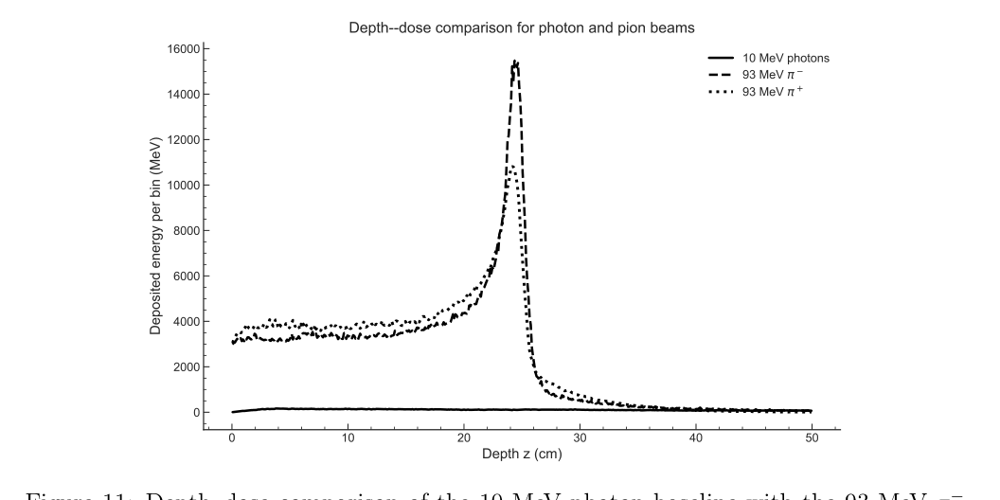
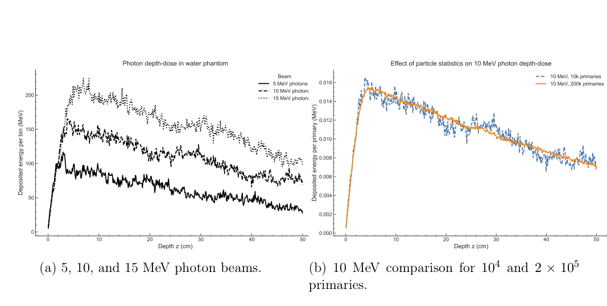
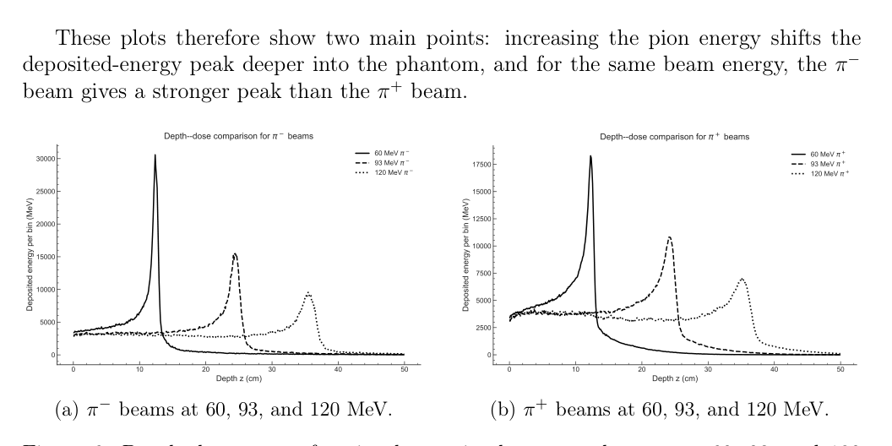
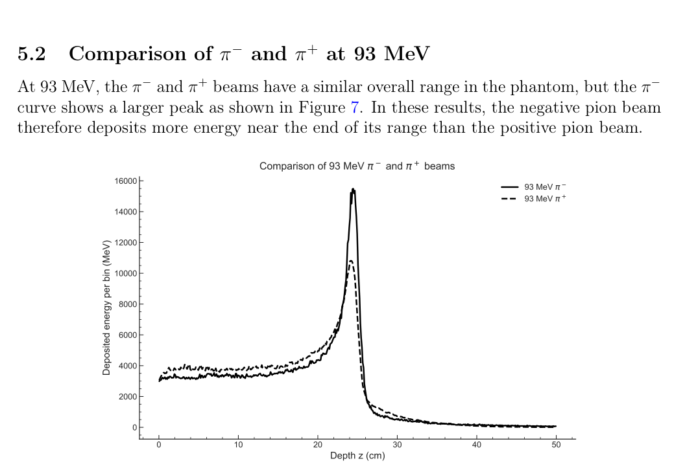
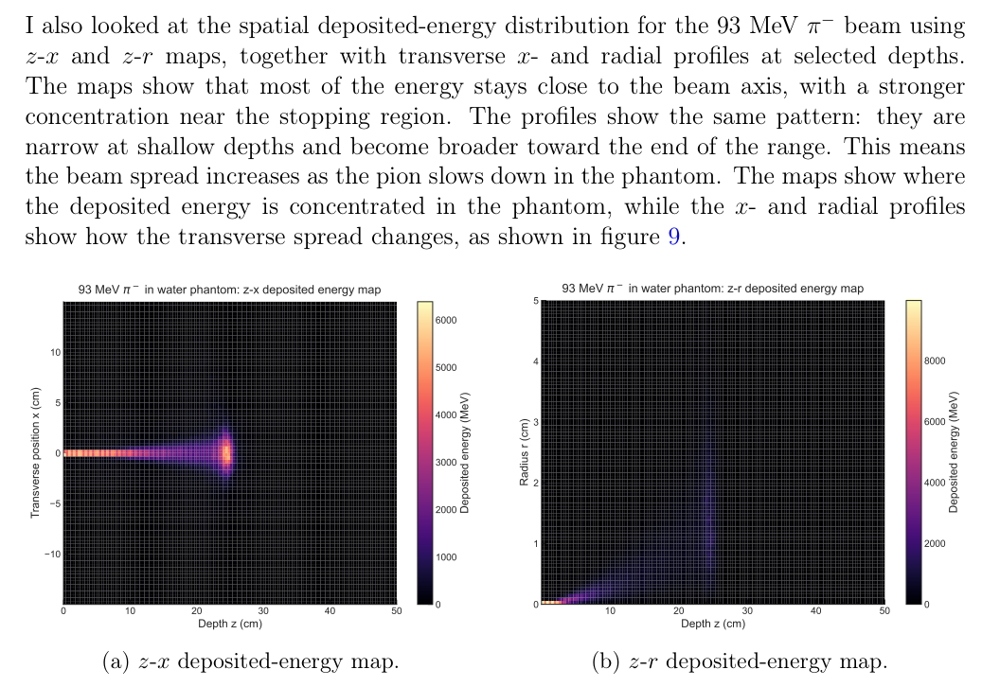
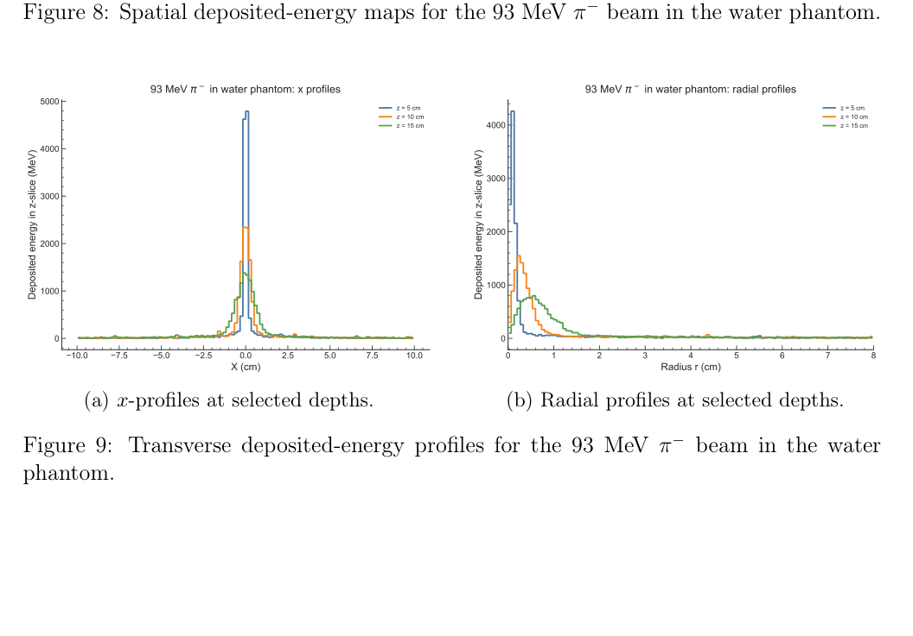
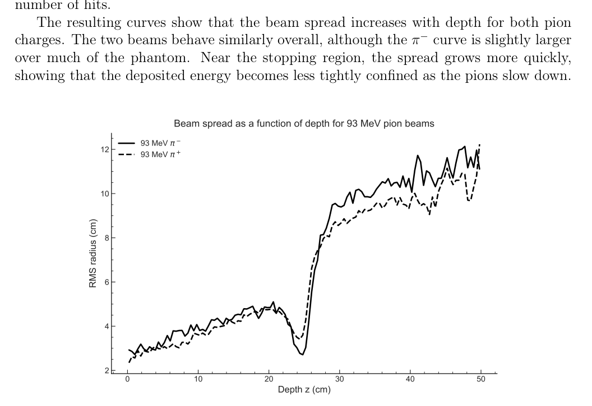
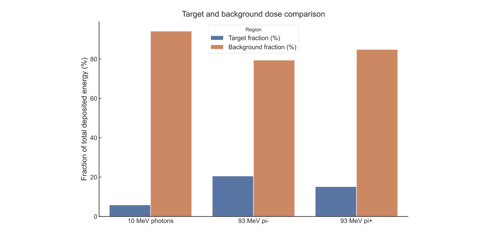
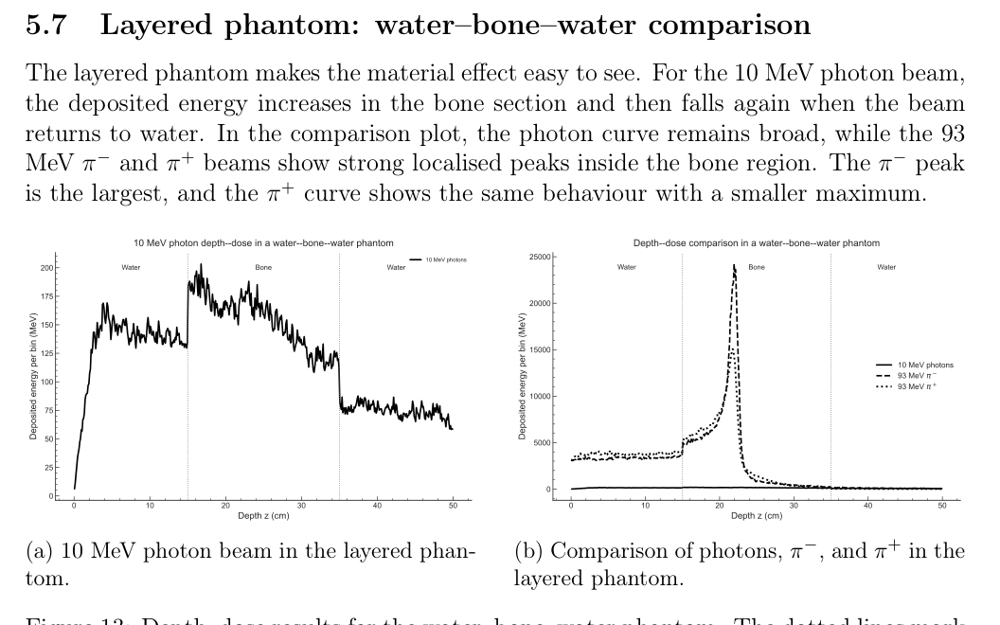

# Geant4 Radiotherapy Depth-Dose Study

**Saqib Umair**  
MSc Particle and Nuclear Physics, University of Edinburgh

This project studies deposited-energy distributions for photon and charged-pion beams in simplified radiotherapy phantoms using the **Geant4-based EdMedPhysics framework**.

The analysis compares:

- 5, 10 and 15 MeV photon beams in water;
- 60, 93 and 120 MeV charged-pion beams;
- 93 MeV `pi-` and `pi+` beams directly;
- a uniform water phantom with a water-bone-water layered phantom;
- longitudinal depth-dose behaviour and transverse beam spreading.

The project was completed as part of Medical Physics coursework. The public repository presents the analysis results and selected figures rather than redistributing the course framework, supplied ROOT macro or raw simulation files.

## Main physics result

The photon and pion beams produce qualitatively different depth-dose distributions.

The 10 MeV photon reference has a broad distribution with a depth of maximum deposited energy of about **3.85 cm**. In comparison, the 93 MeV pion beams peak much deeper:

| Beam | `z_max` | Target fraction within `z_max +/- 1 cm` |
|---|---:|---:|
| 10 MeV photon | 3.85 cm | 5.856% |
| 93 MeV `pi-` | 24.45 cm | **20.557%** |
| 93 MeV `pi+` | 24.15 cm | 15.169% |

The negative-pion beam produces the strongest stopping-region peak in the simulated water phantom.



## Photon baseline

Photon depth-dose distributions were compared at 5, 10 and 15 MeV. Increasing photon energy moves the maximum deeper into the water phantom, while the overall distribution remains broad.

A second 10 MeV run increased the number of primaries from 10,000 to 200,000 to examine Monte Carlo statistical fluctuations. The high-statistics curve is visibly smoother.



## Charged-pion energy dependence

For both pion charges, increasing the beam energy from 60 to 93 to 120 MeV moves the stopping-region peak deeper into the phantom.



At 93 MeV, the `pi-` and `pi+` beams have similar ranges, but the negative-pion simulation produces a higher deposited-energy peak near the stopping region.



The report interprets the stronger `pi-` stopping-region deposition in terms of negative-pion nuclear capture and secondary-particle production after the pion comes to rest.

## Transverse beam spreading

Longitudinal localisation does not imply perfect transverse confinement. Spatial maps and transverse profiles show that the 93 MeV pion beam broadens as it approaches the stopping region.





An energy-weighted RMS radius was used to quantify the transverse spread as a function of depth.



## Target and background regions

A simple target slab of `z_max +/- 1 cm` was used to compare energy deposited near the main stopping region with energy deposited elsewhere in the phantom.

The target fraction rises from **5.856%** for the 10 MeV photon reference to **20.557%** for 93 MeV `pi-` and **15.169%** for 93 MeV `pi+`.



## Water-bone-water phantom

The layered phantom demonstrates the effect of material heterogeneity. In the report, the pion peak moves from about **24.2-24.5 cm** in uniform water to about **21.8-22.0 cm** in the water-bone-water geometry.



This is an important limitation of simplified range-based treatment studies: the stopping position depends on the material composition along the beam path.

## Quantitative results

The numerical values transcribed from the report are provided in:

```text
results/
├── photon_baseline_metrics.csv
├── photon_pion_comparison.csv
├── target_background_fractions.csv
└── layered_phantom_metrics.csv
```

## Tools and workflow

The simulations were produced with the course-provided **EdMedPhysics Geant4 framework**. The project used:

- Geant4 simulation output;
- ROOT analysis;
- the supplied `make_histos.C` macro;
- Python;
- `uproot`;
- NumPy / pandas / Matplotlib-style numerical analysis and plotting.

## Scope and provenance

This repository does **not** claim authorship of the EdMedPhysics simulation framework or the supplied `make_histos.C` ROOT macro.

The public repository also does not redistribute the raw course data or the complete submitted report. The report contains course-specific material and a student identifier, so only selected results and figures are presented here.

The conclusions should be interpreted as results from a simplified Monte Carlo phantom study, not as a clinical treatment recommendation.

---

## Research portfolio

This repository is part of my physics research and scientific-computing portfolio. See my [GitHub profile](https://github.com/saqibumaircheema) for related work in detector instrumentation, particle-physics analysis, simulation, statistical inference and scientific machine learning.
